# FinModPro 系统代码链路文档

> 所有代码路径均基于 `backend/` 下真实源码追踪，更新时间: 2026-05-24

---

## 目录

1. [认证链路 (Authentication)](#1-认证链路)
2. [智能问答链路 (Chat/Q&A)](#2-智能问答链路)
3. [知识库文档摄取链路 (Knowledge Base Ingest)](#3-知识库文档摄取链路)
4. [RAG 检索链路 (Retrieval)](#4-rag-检索链路)
5. [风险抽取链路 (Risk Extraction)](#5-风险抽取链路)
6. [LLM 运维链路 (Model Config / Gateway / Fine-Tune)](#6-llm-运维链路)
7. [系统监控与告警链路 (Monitoring & Alerts)](#7-系统监控与告警链路)
8. [RBAC 用户与权限管理链路](#8-rbac-用户与权限管理链路)
9. [Dashboard 与审计日志链路](#9-dashboard-与审计日志链路)

---

## 1. 认证链路

### 1.1 登录 (Login)

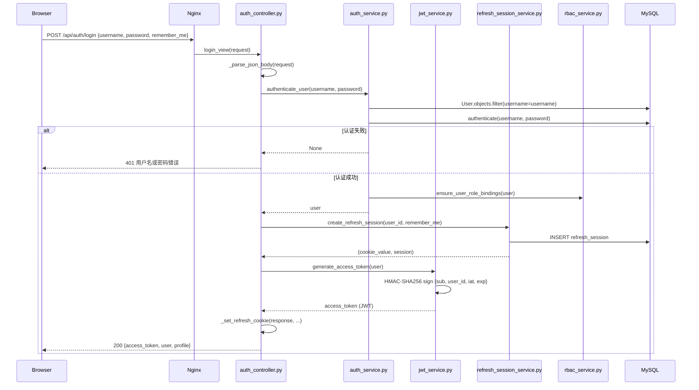

**代码路径:**
- `authentication/controllers/auth_controller.py:145` → `login_view`
- `authentication/services/auth_service.py:45` → `authenticate_user`
- `authentication/services/auth_service.py:22` → `build_user_auth_profile` → `rbac/services/rbac_service.py`
- `authentication/services/jwt_service.py:27` → `generate_access_token` (HMAC-SHA256 自签名 JWT)
- `authentication/services/refresh_session_service.py` → `create_refresh_session`

### 1.2 Token 刷新 (Refresh)

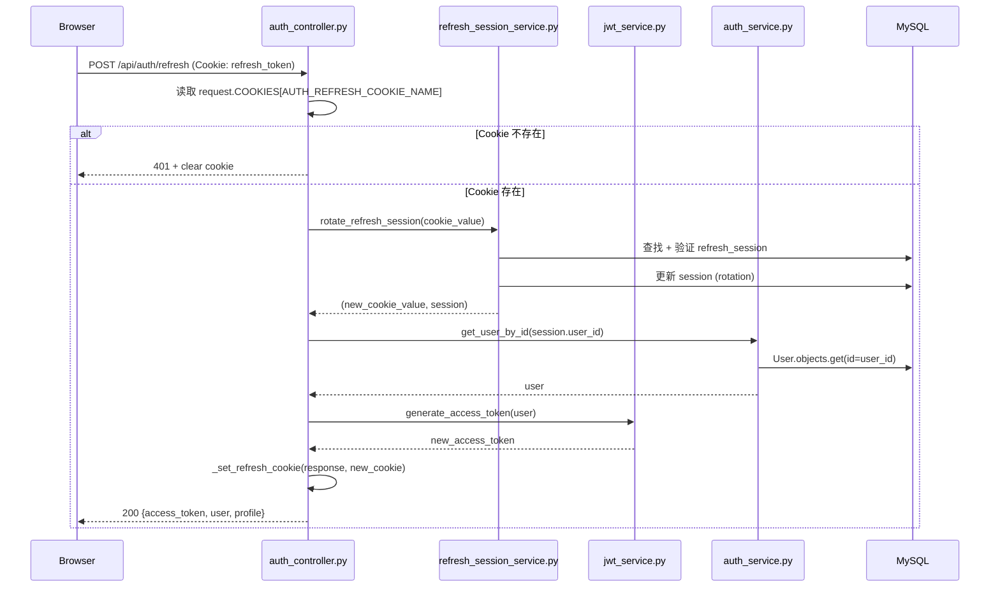

### 1.3 DRF 请求认证中间件

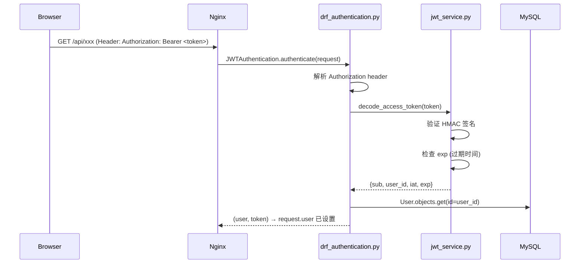

**代码路径:**
- `authentication/drf_authentication.py:8` → `JWTAuthentication`
- `authentication/services/jwt_service.py:56` → `decode_access_token`

---

## 2. 智能问答链路

### 2.1 非流式问答 (POST /api/chat/ask)

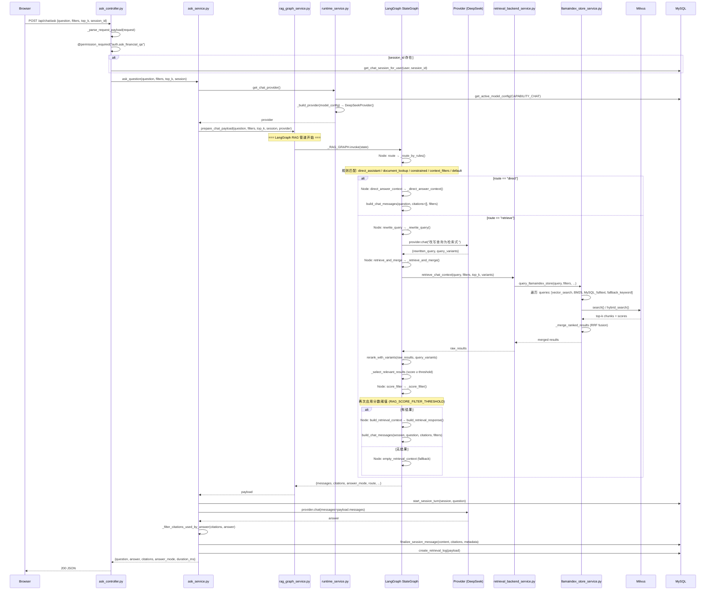

### 2.2 流式问答 (POST /api/chat/ask/stream)

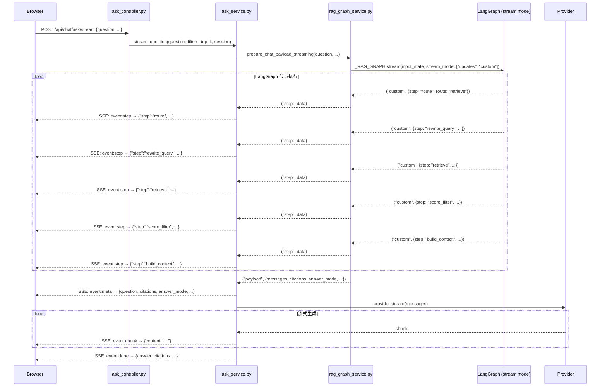

**代码路径:**
- `chat/controllers/ask_controller.py:191` → `chat_ask_view`
- `chat/controllers/ask_controller.py:225` → `chat_ask_stream_view`
- `chat/services/ask_service.py:71` → `ask_question`
- `chat/services/ask_service.py:131` → `stream_question`
- `chat/services/rag_graph_service.py:557` → `prepare_chat_payload`
- `chat/services/rag_graph_service.py:599` → `prepare_chat_payload_streaming`
- `chat/services/rag_graph_service.py:520` → `_build_rag_graph` (LangGraph StateGraph 定义)
- `chat/services/context_service.py` → `build_chat_messages`
- `chat/services/session_service.py` → `start_session_turn`, `finalize_session_message`
- `rag/services/retrieval_backend_service.py:14` → `retrieve_chat_context`

**LangGraph 节点顺序:**
```
START → route → (direct → direct_answer_context → END)
              → (retrieve → rewrite_query → retrieve_and_merge → score_filter
                   → build_retrieval_context → END
                   → empty_retrieval_context → END)
```

---

## 3. 知识库文档摄取链路

### 3.1 文档上传 + 摄取 (Upload → Ingest Pipeline)

```mermaid
sequenceDiagram
    participant Browser
    participant DocCtrl as document_controller.py
    participant IngestCtrl as ingest_controller.py
    participant DocSvc as document_service.py
    participant ParserSvc as parser_service.py
    participant CleanEngine as cleaning_engine_service.py
    participant ChunkSvc as chunk_service.py
    participant VectorSvc as vector_service.py
    participant LlamaIndex as llamaindex_store_service.py
    participant Celery as Celery Worker
    participant Milvus
    participant DB as MySQL

    Note over Browser,DB: === 第 1 步: 文件上传 ===
    Browser->>DocCtrl: POST /api/knowledgebase/documents (multipart/form-data: file)
    DocCtrl->>DocCtrl: @permission_required("auth.view_document" / "auth.upload_document")
    DocCtrl->>DocCtrl: 校验: file 必填, 大小 ≤ 50MB
    DocCtrl->>DocSvc: create_document_from_upload(uploaded_file, title, ...)
    DocSvc->>DocSvc: _detect_doc_type(filename)  # txt/pdf/docx
    DocSvc->>DocSvc: _compute_file_hash(uploaded_file)  # SHA-256
    DocSvc->>DB: 检查重复 (file_hash + file_size)
    alt 重复
        DocSvc-->>DocCtrl: DuplicateDocumentError → 409
    end
    DocSvc->>DB: Document.objects.create(title, file, file_hash, ...)
    DocSvc->>DB: DocumentVersion.objects.create(version_number=1, is_current=True)
    DocSvc-->>DocCtrl: document
    DocCtrl->>DB: record_audit_event("knowledgebase.document.upload", succeeded)
    DocCtrl-->>Browser: 201 {document}

    Note over Browser,DB: === 第 2 步: 触发摄取 ===
    Browser->>IngestCtrl: POST /api/knowledgebase/documents/{id}/ingest
    IngestCtrl->>DocSvc: enqueue_document_ingestion(document)
    DocSvc->>DB: SELECT FOR UPDATE document (防并发)
    DocSvc->>DB: 检查是否有进行中的 IngestionTask
    alt 已有进行中任务
        DocSvc-->>IngestCtrl: (existing_task, created=False) → 200 "已有进行中的摄取任务。"
    end
    DocSvc->>DB: IngestionTask.objects.create(status=QUEUED, step=QUEUED)
    DocSvc->>Celery: ingest_document_task.delay(document_id, task_id)
    DocSvc-->>IngestCtrl: (task, created=True)

    Note over Celery,DB: === 第 3 步: Celery 异步执行摄取管道 ===
    Celery->>DocSvc: ingest_document(document, ingestion_task)
    DocSvc->>DocSvc: _mark_ingestion_task_running(STEP_PARSING)

    DocSvc->>ParserSvc: parse_document_file(document)  # Unstructured API
    ParserSvc-->>DocSvc: {parsed_text, elements, document_metadata, chunk_metadata_defaults}
    DocSvc->>DB: document.parsed_text = result; status = PARSED

    DocSvc->>DocSvc: status → CLEANING (清洗阶段)
    DocSvc->>CleanEngine: clean_document(document=document)
    CleanEngine->>CleanEngine: 应用清洗规则 (去噪/格式化/去重)
    CleanEngine-->>DocSvc: CleaningResult(cleaned_text, quality_score)
    DocSvc->>CleanEngine: evaluate_quality_gate(quality_score)
    alt 质量不达标
        DocSvc-->>Celery: DocumentQualityGateError → document.status=FAILED
    end

    DocSvc->>DocSvc: chunk_document(document, parser_result)
    DocSvc->>DocSvc: choose_chunking_strategy() → flat/hierarchical
    alt hierarchical strategy
        DocSvc->>ChunkSvc: build_hierarchical_document_chunks(text, elements)
        DocSvc->>DB: bulk_create DocumentSectionChunk + DocumentChunk (父子结构)
    else flat strategy
        DocSvc->>ChunkSvc: build_document_chunks / build_document_chunks_from_elements
        DocSvc->>DB: bulk_create DocumentChunk (+ search_text)
    end

    DocSvc->>VectorSvc: vectorize_document(document)
    VectorSvc->>VectorSvc: index_document_chunks(document)
    VectorSvc->>VectorSvc: 遍历所有 chunk, 调用 embedding_provider
    VectorSvc->>Milvus: insert(vectors + metadata)  # batch insert
    VectorSvc->>LlamaIndex: sync_document(document)
    LlamaIndex->>LlamaIndex: invalidate_bm25_cache()

    DocSvc->>DB: document.status = INDEXED; task.status = SUCCEEDED
    DocSvc-->>Celery: document
```

**摄取管道阶段顺序:**
```
UPLOADED → QUEUED → PARSING → CLEANING → CHUNKING → INDEXING → GRAPH_SYNC → COMPLETED (INDEXED)
```

**代码路径:**
- `knowledgebase/controllers/document_controller.py:38` → `document_list_create_view`
- `knowledgebase/controllers/ingest_controller.py:37` → `document_ingest_view`
- `knowledgebase/services/document_service.py:493` → `create_document_from_upload`
- `knowledgebase/services/document_service.py:977` → `enqueue_document_ingestion`
- `knowledgebase/services/document_service.py:826` → `ingest_document` (核心管道)
- `knowledgebase/services/document_service.py:667` → `parse_document`
- `knowledgebase/services/document_service.py:677` → `chunk_document`
- `knowledgebase/services/document_service.py:782` → `vectorize_document`
- `knowledgebase/tasks.py:7` → `ingest_document_task` (Celery 入口)

### 3.2 文档删除链路

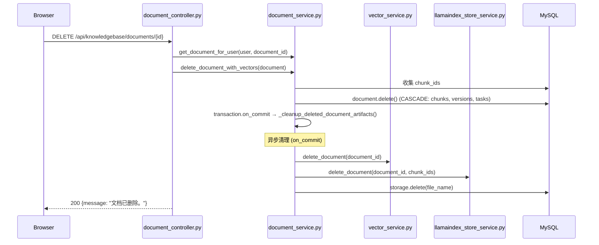

---

## 4. RAG 检索链路

### 4.1 多策略并行检索

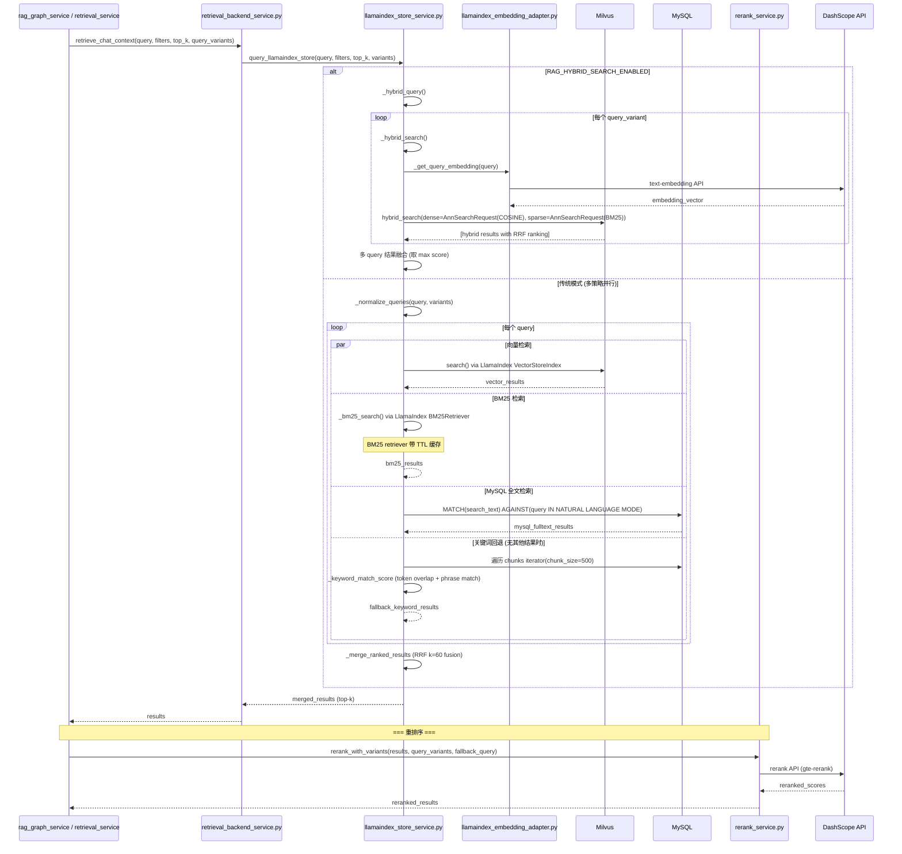

**代码路径:**
- `rag/services/retrieval_service.py:44` → `retrieve` (独立 RAG API 入口)
- `rag/services/retrieval_backend_service.py:4` → `retrieve_rag_context`
- `rag/services/retrieval_backend_service.py:14` → `retrieve_chat_context`
- `rag/services/llamaindex_store_service.py:793` → `query_llamaindex_store` (主检索入口)
- `rag/services/llamaindex_store_service.py:435` → `search` (LlamaIndex 向量检索)
- `rag/services/llamaindex_store_service.py:310` → `_bm25_search` (BM25 检索)
- `rag/services/llamaindex_store_service.py:546` → `_mysql_full_text_search` (MySQL 全文检索)
- `rag/services/llamaindex_store_service.py:674` → `_fallback_keyword_search` (关键词回退)
- `rag/services/llamaindex_store_service.py:349` → `_hybrid_search` (Milvus 原生混合检索)
- `rag/services/llamaindex_store_service.py:508` → `_merge_ranked_results` (RRF 融合)
- `rag/services/rerank_service.py` → `rerank_with_variants`, `rerank_results`

---

## 5. 风险抽取链路

### 5.1 文档风险事件抽取

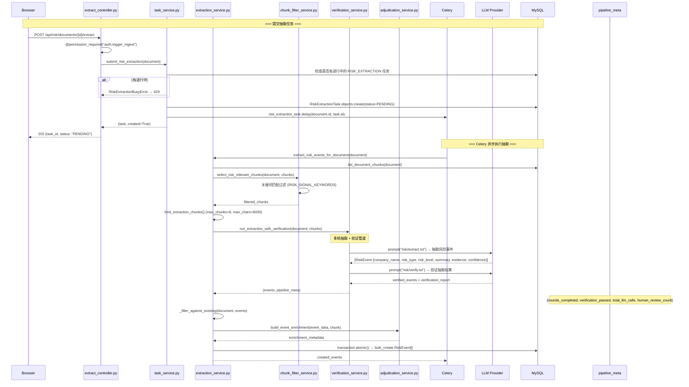

### 5.2 风险抽取轮询

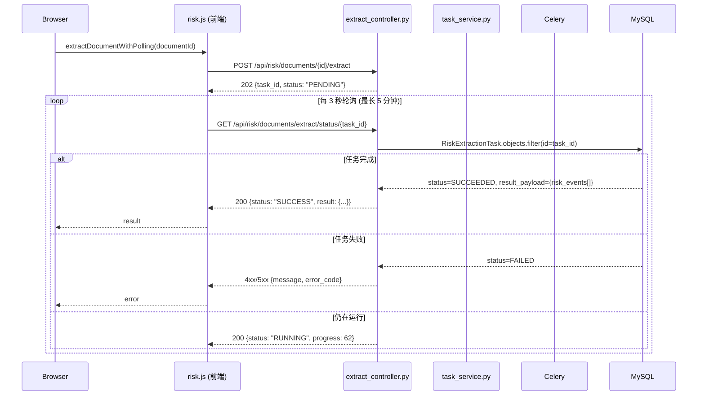

**代码路径:**
- `risk/controllers/extract_controller.py:21` → `RiskDocumentExtractView`
- `risk/controllers/extract_controller.py:185` → `RiskExtractStatusView`
- `risk/services/extraction_service.py:153` → `extract_risk_events_for_document`
- `risk/services/extraction_service.py:89` → `list_document_chunks`
- `risk/services/extraction_service.py:141` → `detect_risk_signals`
- `risk/services/chunk_filter_service.py` → `select_risk_relevant_chunks`
- `risk/services/extraction_service.py:109` → `limit_extraction_chunks`
- `risk/services/verification_service.py` → `run_extraction_with_verification`
- `risk/services/adjudication_service.py` → `build_event_enrichment`
- `risk/services/extraction_service.py:33` → `_filter_against_existing`
- `risk/services/task_service.py` → `submit_risk_extraction`, `serialize_risk_extraction_task`
- `frontend/src/api/risk.js:94` → `extractDocumentWithPolling`

---

## 6. LLM 运维链路

### 6.1 模型配置管理 + Provider 解析

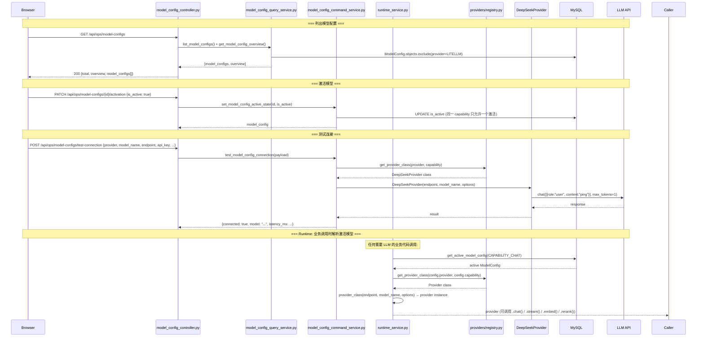

**代码路径:**
- `llm/controllers/model_config_controller.py:62` → `ModelConfigListView`
- `llm/controllers/model_config_controller.py:100` → `ModelConfigDetailView`
- `llm/controllers/model_config_controller.py:175` → `ModelConfigActivationView`
- `llm/controllers/model_config_controller.py:216` → `ModelConfigConnectionTestView`
- `llm/services/model_config_service.py:5` → `get_manageable_model_configs`
- `llm/services/model_config_service.py:9` → `get_active_model_config`
- `llm/services/model_config_command_service.py` → `create_model_config`, `update_model_config`, `test_model_config_connection`
- `llm/services/model_config_query_service.py` → `list_model_configs`, `get_model_config_overview`
- `llm/services/runtime_service.py:35` → `get_chat_provider`
- `llm/services/runtime_service.py:46` → `get_embedding_provider`
- `llm/services/runtime_service.py:51` → `get_rerank_provider`
- `llm/services/providers/registry.py` → `get_provider_class`
- `llm/services/providers/deepseek_provider.py` → `DeepSeekProvider`
- `llm/services/providers/dashscope_provider.py` → `DashScopeProvider`

### 6.2 LLM Gateway 分析

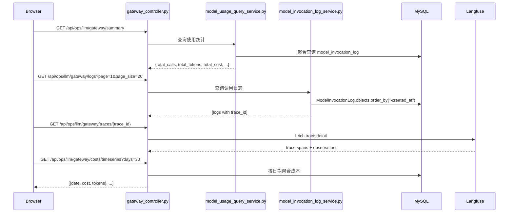

**代码路径:**
- `llm/controllers/gateway_controller.py` → `GatewaySummaryView`, `GatewayLogsView`, `GatewayTraceView`
- `llm/services/model_usage_query_service.py` → 使用统计查询
- `llm/services/model_invocation_log_service.py` → 调用日志记录

---

## 7. 系统监控与告警链路

### 7.1 指标采集 + 告警评估

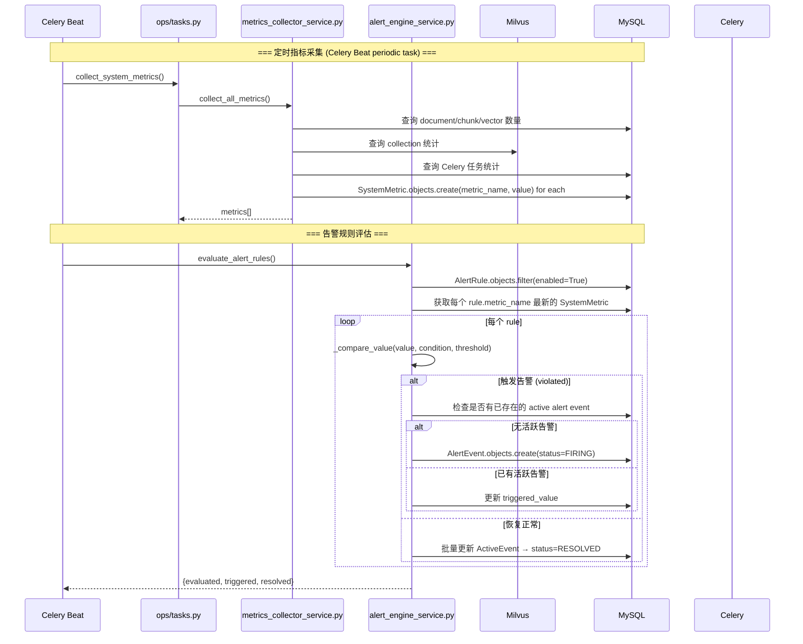

### 7.2 前端监控查询

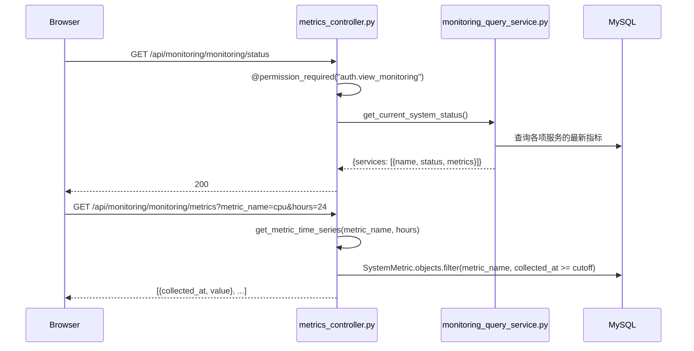

**代码路径:**
- `ops/controllers/metrics_controller.py:17` → `SystemStatusView`
- `ops/controllers/metrics_controller.py:29` → `MetricTimeSeriesView`
- `ops/controllers/alert_rule_controller.py` → `AlertRuleListView`, `AlertRuleDetailView`
- `ops/controllers/alert_event_controller.py` → `AlertEventListView`, `AlertEventAcknowledgeView`
- `ops/services/metrics_collector_service.py` → `collect_all_metrics`
- `ops/services/monitoring_query_service.py` → `get_current_system_status`, `get_metric_time_series`
- `ops/services/alert_engine_service.py:13` → `evaluate_alert_rules`
- `ops/tasks.py` → Celery 定时任务

---

## 8. RBAC 用户与权限管理链路

### 8.1 用户管理

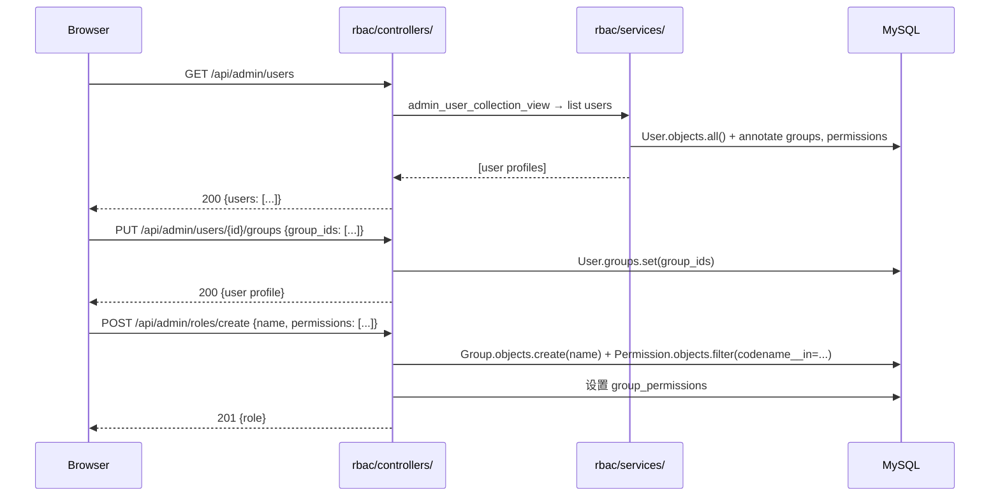

### 8.2 权限检查链路

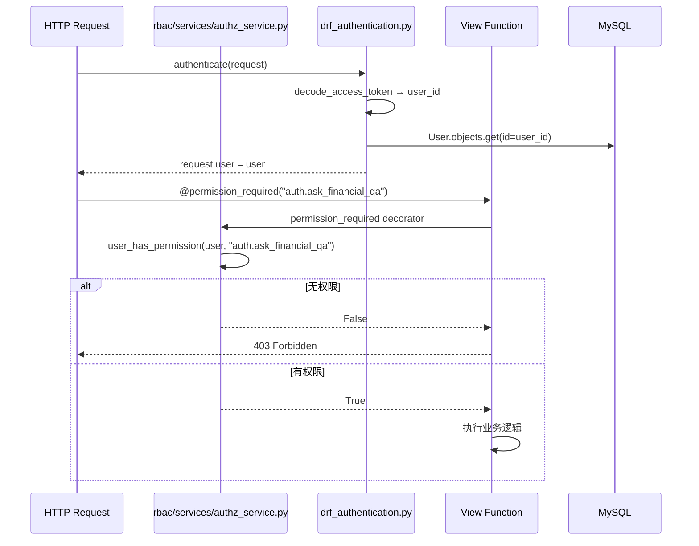

**代码路径:**
- `rbac/controllers/` → user/group/role CRUD 控制器
- `rbac/services/rbac_service.py` → `assign_default_member_group`, `collect_user_groups`, `collect_user_permission_names`
- `rbac/services/authz_service.py` → `permission_required`, `user_has_permission`
- `rbac/management/commands/seed_rbac.py` → 初始化 RBAC 角色 (super_admin, admin, member)

---

## 9. Dashboard 与审计日志链路

### 9.1 Dashboard 总览

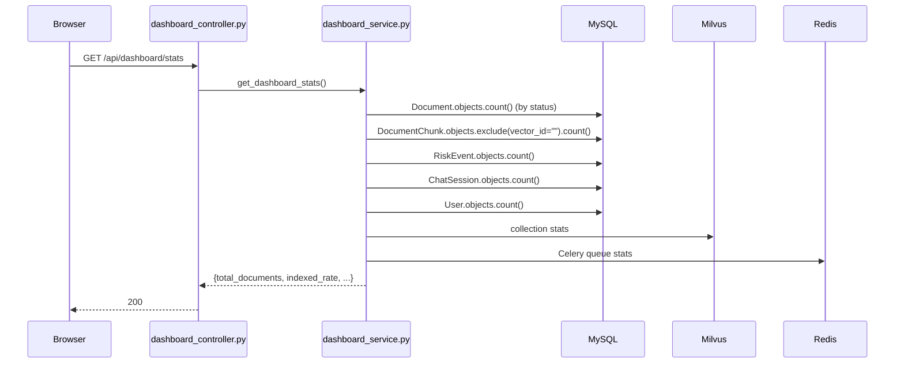

### 9.2 审计日志

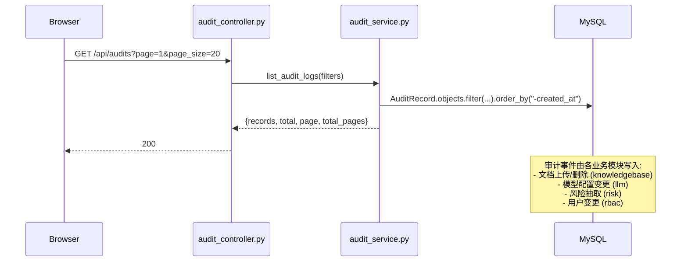

**代码路径:**
- `systemcheck/controllers/dashboard_controller.py` → `DashboardStatsView`
- `systemcheck/services/dashboard_service.py` → dashboard 数据聚合
- `systemcheck/controllers/audit_controller.py` → `AuditLogListView`
- `systemcheck/services/audit_service.py` → `record_audit_event`
- `systemcheck/controllers/health_controller.py` → `HealthView`

---

## 前端 API 层总览

所有前端 API 调用通过 `frontend/src/api/config.js` 的 `createApiConfig()` 统一管理:

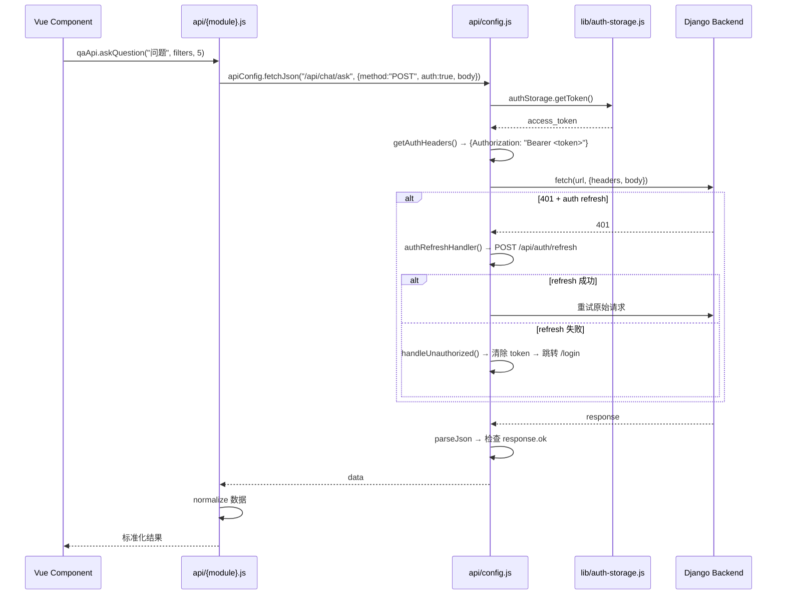

**前端 API 模块文件:**
| 文件 | 用途 |
|------|------|
| `api/config.js` | 核心 HTTP 客户端 (fetch 封装, Auth header, CSRF, 401 拦截/刷新) |
| `api/auth.js` | 登录/注册/登出/密码重置 |
| `api/qa.js` | 智能问答 (非流式 + SSE 流式) |
| `api/knowledgebase.js` | 知识库 (文档 CRUD, 上传, 摄取, 版本管理) |
| `api/chat.js` | 会话管理 (sessions, messages, memories) |
| `api/risk.js` | 风险分析 (抽取 + 轮询, 报表, 事件, 导出) |
| `api/llm.js` | 模型配置管理 |
| `api/llm-gateway.js` | LLM 网关分析 (摘要, 日志, Trace, 成本) |
| `api/llm-console.js` | LLM 控制台总览 |
| `api/admin.js` | 用户/角色/权限管理 |
| `api/dashboard.js` | Dashboard 统计 |
| `api/monitoring.js` | 系统监控 (状态, 指标, 告警) |
| `api/cleaning.js` | 文档清洗规则管理 |
| `api/ops.js` | 运维信息 (存根) |

---

## 附录: 技术栈速览

| 层 | 技术 |
|---|------|
| **前端框架** | Vue 3 + Vite + Vue Router |
| **后端框架** | Django 5 + Django REST Framework |
| **异步任务** | Celery + Redis |
| **数据库** | MySQL 8.4 |
| **向量存储** | Milvus standalone |
| **RAG 框架** | LlamaIndex (LangGraph for chat RAG pipeline) |
| **LLM 网关** | LiteLLM (port 4000) |
| **观测性** | Langfuse |
| **嵌入/重排** | DashScope (阿里云) |
| **LLM 模型** | DeepSeek (via LiteLLM) |
| **部署** | Docker Compose (10 服务) + Nginx 反向代理 |
